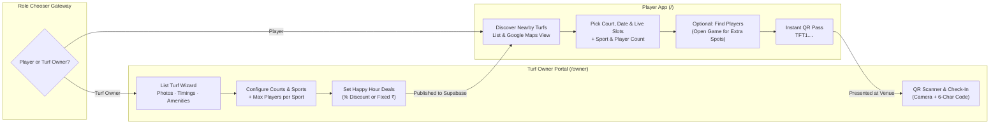

<div align="center">


# 🏟️ Turffet

**Discover, Book & Manage Sports Turfs Across Delhi NCR**

*Fill empty off-peak turf hours · Book live slots in seconds · Find teammates · Check in with cryptographic QR passes*

[](https://react.dev/)
[](https://www.typescriptlang.org/)
[](https://vite.dev/)
[](https://tailwindcss.com/)
[](https://supabase.com/)
[](#progressive-web-app--offline-qr-passes)

</div>

---

## 💡 The Problem We Solve

Across cities like **Delhi NCR**, dozens of quality sports turfs (Football, Box Cricket, Badminton, Pickleball, Tennis, Basketball, Volleyball) sit **empty for hours every day** because:
1. **Low local discovery:** Players don't know which turfs exist near them or what sports/amenities they offer.
2. **Rigid pricing during off-peak hours:** Daytime and weekday slots go unbooked without dynamic **Happy Hour / Off-Peak deals**.
3. **Incomplete squads:** Groups often cancel because they are short by 2–4 players and have no way to find local players for that exact slot.
4. **Manual booking chaos:** Calling or messaging on WhatsApp leads to double bookings and no-shows, with no unified check-in system at the venue.

**Turffet** solves both sides of the marketplace with a dual-mode platform:
- **Player App** — Discover owner-registered turfs near you, filter by sport/price/Happy Hour/amenities, book up to 3 consecutive slots, optionally open your game to **"Find Players"**, and receive an **HMAC-signed QR Booking Pass** that works even offline.
- **Turf Owner Portal** — List your turf with photos, operating hours, multiple courts/pitches, sports & per-sport max player capacities, Happy Hour % or fixed-price deals, walk-in/maintenance slot blocks, and a built-in **Camera QR Scanner** to verify and check in players on arrival.

---

## ✨ Key Features

### 🚪 Dual-Role Entry Gateway (`Player` vs. `Turf Owner`)
When a user lands on **Turffet**, they choose their role immediately—and can switch between **Player App** and **Turf Owner Portal** anytime with a single tap from the header:
- **I'm a Player** → Directs to the turf discovery, slot booking & Find Players experience (`/`).
- **I'm a Turf Owner** → Directs to the Partner Portal to list and manage turfs, deals, and QR check-ins (`/owner`).

---

### ⚽ For Players (Client Side)

| Feature | Description |
| :--- | :--- |
| **📍 Geospatial Discovery (PostGIS + Google Maps)** | Browse turfs sorted by live GPS distance or switch between 18 Delhi NCR hubs (Hauz Khas, Cyber City, Sector 62 Noida, Dwarka, Connaught Place, etc.) in **List** or interactive **Dark Map** view with live price pins. |
| **⚡ Happy Hour & Smart Filters** | Filter by sport (`⚽ Football`, `🏏 Box Cricket`, `🏸 Badminton`, `🏓 Pickleball`, `🎾 Tennis`, `🏀 Basketball`, `🏐 Volleyball`), max hourly budget, 13 facility amenities, and **Happy Hour / Off-Peak deals**. |
| **🕒 Live Slot Grid (Supabase Realtime)** | Pick any court/pitch and date up to 14 days ahead. Select up to **3 back-to-back slots** with instant Happy Hour savings calculation and database-level double-booking protection (` tstzrange` exclusion constraint). |
| **👥 Per-Sport Player Count & "Find Players"** | Specify how many players are coming (dynamically capped by the court's max capacity for the chosen sport). Short a few teammates? Toggle **"Looking for more players?"** during checkout to publish your game to the **Find Players** feed. |
| **🎟️ Cryptographic QR Booking Pass** | Every booking generates a 6-character code (e.g., `#K7M9P2`) and a tamper-proof HMAC-SHA256 QR token (`TFT1.<booking_id>.<code>.<hmac24>`). Passes are cached in `localStorage` so your QR displays at the venue gate even with zero mobile signal. |
| **🛡️ 2-Hour Cancellation & Fair-Play System** | Cancel for free up to **2 hours** before kick-off. Verified check-ins unlock post-match ratings & reviews, while repeated unexcused no-shows are tracked via fair-play strikes. |
| **🔔 Web Push Match Reminders** | Installable PWA with Service Worker Web Push notifications (`VAPID`) for booking confirmations, join requests, and 2-hour pre-match reminders. |

---

### 🏢 For Turf Owners (Partner Portal · `/owner`)

| Feature | Description |
| :--- | :--- |
| **📊 Live Owner Dashboard** | Real-time KPIs for **Today's Bookings**, **Checked-In Squads**, **Today's & 7-Day Revenue**, and **Slot Occupancy %**, plus an upcoming bookings feed with 1-tap check-in. |
| **🏗️ 6-Step Turf Listing & Editing Wizard** | Everything a player needs to book your venue:<br/>1. **Venue Info & Interactive Map Pin:** Name, Delhi NCR hub or custom area, full street address, description, contact phone & WhatsApp, slot duration (`30`/`60`/`90`/`120` min), and click-to-pin Google Map + GPS locator.<br/>2. **Turf Photos:** Upload directly to Supabase Storage (`turf-photos` bucket), paste URLs, or pick from high-res sport presets; choose your cover image.<br/>3. **Operating Timings:** Day-by-day (`Sun`–`Sat`) open/close hours, closed toggle, and **"Copy Monday to All Days"** shortcut.<br/>4. **Courts, Sports & Per-Sport Max Players:** Add multiple courts/pitches (`name`, `size_label`, `surface`, regular ₹/slot `base_price`, overall `max_players`), select playable sports per court, and set the **exact max players for each sport** (e.g., Football: `12`, Box Cricket: `16`, Badminton: `4`).<br/>5. **Happy Hour Deals & Peak Pricing:** One-click templates (*Weekday Happy Hour 30% OFF*, *Early Bird 35% OFF*, *Midday Fixed Deal*, *Weekend Prime*) or custom rules by court, days of week, time window, and **% Discount** or **Fixed ₹ Price**.<br/>6. **Amenities & Venue Rules:** Multi-select from 13 amenities (`Floodlights`, `Parking`, `Washroom`, `Changing Room`, `Drinking Water`, `Shower`, `Cafe`, `Equipment Rental`, `Player Dugout`, `First Aid`, `CCTV`, `AC`, `Wi-Fi`) + custom turf rules. |
| **📷 Camera QR Scanner & Code Verification** | Built-in `jsqr` camera scanner at `/owner/scan` (plus manual 6-character code lookup). Verifies the HMAC-SHA256 signature, displays the player's name, phone, sport, court, **number of players arriving**, and **amount to collect at the venue**, and marks the booking `checked_in` in one tap. |
| **🗓️ Walk-In Bookings & Maintenance Slot Blocker** | Manage all bookings by date and turf at `/owner/bookings`. Record offline **Walk-In Customers**, block slots for turf maintenance, mark no-shows, or cancel slots with automated player notifications. |

---

## 🧭 Architecture & Booking Flow



---

## 🛠️ Tech Stack

- **Frontend:** React 19, TypeScript 5.9, Vite 8, React Router v7, TanStack React Query v5
- **Styling & UI:** Tailwind CSS v4 (custom dark turf theme `#0B0F0C` with neon-lime accents `#B6FF3B`), Lucide Icons
- **Maps & Geolocation:** Google Maps JavaScript API (`@vis.gl/react-google-maps`) + PostGIS `geography(Point, 4326)` spatial indexing
- **Backend & Database:** Supabase (PostgreSQL 17, Row-Level Security, PL/pgSQL RPCs, `btree_gist` exclusion constraints for zero double-bookings, `pgcrypto` HMAC-SHA256 QR signing, Supabase Realtime, Supabase Storage `turf-photos`)
- **QR Generation & Scanning:** `qrcode` (SVG/DataURL pass generation) + `jsqr` (live camera QR verification)
- **PWA & Push:** `vite-plugin-pwa` (Workbox service worker + offline pass cache) + Supabase Edge Function (`send-push`) using Web Push VAPID keys

---

## 📂 Project Structure

```text
Turffet/
├── public/
│   ├── icons/                      # PWA maskable icons, Apple touch icon & SVG favicon
│   ├── images/turfs/               # High-resolution sport & turf preset photography
│   └── push-sw.js                  # Service Worker handler for Web Push notifications
├── scripts/
│   ├── generate-icons.mjs          # Generates PWA icon sizes from source artwork
│   └── push-supabase.mjs           # Applies SQL migrations & generates full_setup.sql
├── src/
│   ├── components/
│   │   ├── RoleGateway.tsx         # Entry chooser ("I'm a Player" vs "I'm a Turf Owner")
│   │   ├── Layout.tsx              # Player app shell & bottom navigation
│   │   ├── OwnerLayout.tsx         # Turf Owner Portal shell & onboarding bar
│   │   ├── TurfCard.tsx            # Turf discovery card with Happy Hour & sport badges
│   │   ├── TurfMap.tsx             # Interactive Google Map with live price markers
│   │   ├── BookingSheet.tsx        # Checkout sheet with per-sport player cap & Find Players
│   │   ├── FilterSheet.tsx         # Price, Happy Hour, radius & amenity filters
│   │   └── ReviewSheet.tsx         # Verified player rating & review modal
│   ├── lib/
│   │   ├── api.ts                  # Player React Query hooks & Realtime subscriptions
│   │   ├── ownerApi.ts             # Turf Owner Portal RPC hooks & photo upload helper
│   │   ├── auth.tsx                # Supabase Phone/Email OTP Auth provider
│   │   ├── location.tsx            # GPS & Delhi NCR area preset provider
│   │   ├── offlinePasses.ts        # LocalStorage cache for offline QR booking passes
│   │   └── types.ts                # Shared TypeScript interfaces
│   └── pages/
│       ├── ExplorePage.tsx         # Player turf discovery (List + Map + Filters)
│       ├── TurfDetailPage.tsx      # Gallery, courts, live slot grid & Happy Hour banner
│       ├── BookingsPage.tsx        # Player upcoming & past bookings
│       ├── BookingPassPage.tsx     # Full-screen QR pass, booking code & directions
│       ├── GamesPage.tsx           # "Find Players" open games feed
│       ├── GameDetailPage.tsx      # Host roster management & join request approval
│       └── owner/
│           ├── OwnerDashboardPage.tsx   # Revenue, occupancy, listed turfs & check-ins
│           ├── OwnerTurfEditorPage.tsx  # 6-step wizard to list/edit a turf
│           ├── OwnerScanPage.tsx        # Camera QR scanner & 6-char code verifier
│           └── OwnerBookingsPage.tsx    # Date/turf schedule, walk-ins & slot blocking
└── supabase/
    ├── functions/send-push/        # Deno Edge Function for Web Push notifications
    ├── migrations/                 # Ordered PostgreSQL + PostGIS schema & RPC migrations
    └── full_setup.sql              # Combined one-click SQL setup bundle
```

---

## 🚀 Getting Started Locally

### 1. Clone & Install Dependencies

```bash
git clone https://github.com/RJ025/Turffet.git
cd Turffet
npm install
```

### 2. Configure Environment Variables

Copy `.env.example` to `.env` and fill in your project keys:

```bash
cp .env.example .env
```

```dotenv
VITE_SUPABASE_URL=https://your-project.supabase.co
VITE_SUPABASE_PUBLISHABLE_KEY=sb_publishable_xxx
VITE_GOOGLE_MAPS_API_KEY=your-google-maps-key
VITE_GOOGLE_MAP_ID=DEMO_MAP_ID
VITE_VAPID_PUBLIC_KEY=your-vapid-public-key
```

### 3. Apply Database Migrations to Supabase

You can either paste [`supabase/full_setup.sql`](supabase/full_setup.sql) directly into the **Supabase SQL Editor**, or push all migrations automatically using a Supabase Personal Access Token (`sbp_...`):

```bash
SUPABASE_ACCESS_TOKEN=sbp_xxx SUPABASE_PROJECT_REF=your_project_ref node scripts/push-supabase.mjs
```

### 4. Start the Development Server

```bash
npm run dev
```

Open **http://localhost:3000** in your browser.

### 5. Build for Production

```bash
npm run build
npm run preview
```

---

## 🔐 Security Highlights

- **Zero Double-Bookings:** Enforced in PostgreSQL via a `btree_gist` exclusion constraint (`bookings_no_overlap`) on `(court_id WITH =, tstzrange(starts_at, ends_at, '[)') WITH &&) WHERE (status IN ('confirmed', 'checked_in'))`.
- **Tamper-Proof QR Passes:** QR tokens (`TFT1.<booking_id>.<code>.<hmac24>`) are signed server-side using `pgcrypto` `hmac(..., 'sha256')` with a secret key stored in a locked `private.app_secrets` schema inaccessible to client roles.
- **Strict Row-Level Security (RLS):** Every table (`profiles`, `turfs`, `courts`, `operating_hours`, `pricing_rules`, `bookings`, `open_games`, `join_requests`, `reviews`, `favourites`, `notifications`) has RLS enabled, and state transitions run through validated `SECURITY DEFINER` RPCs.
- **Owner-Only Listings:** Only turfs explicitly registered and published by turf owners on the Owner Portal (`owner_id IS NOT NULL AND is_active = true`) are visible on the client side.

---

<div align="center">
  Built with ⚡ for players and turf owners across Delhi NCR.
</div>
